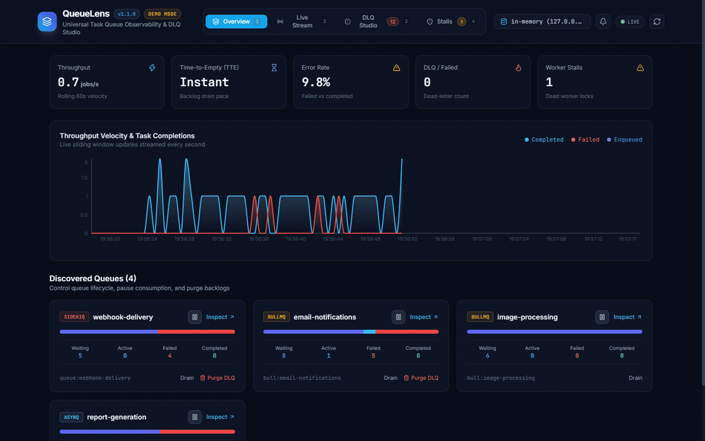
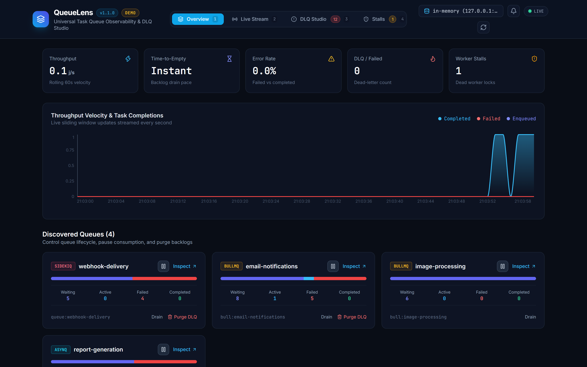
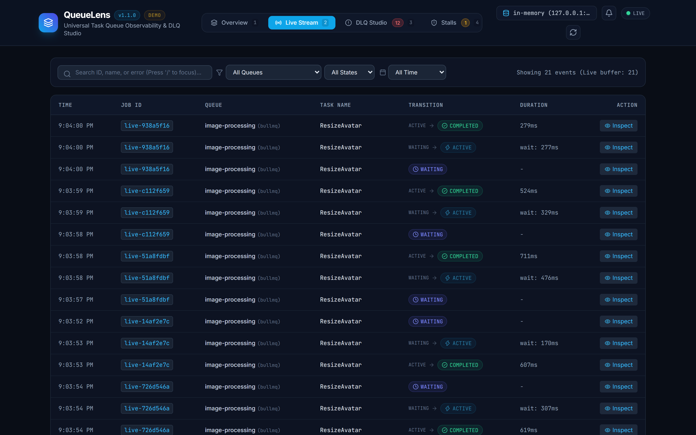
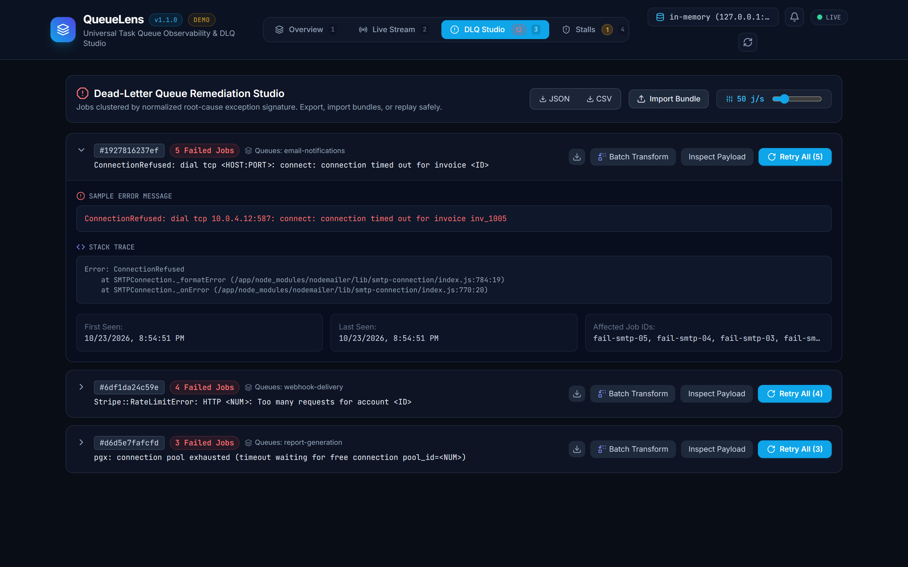
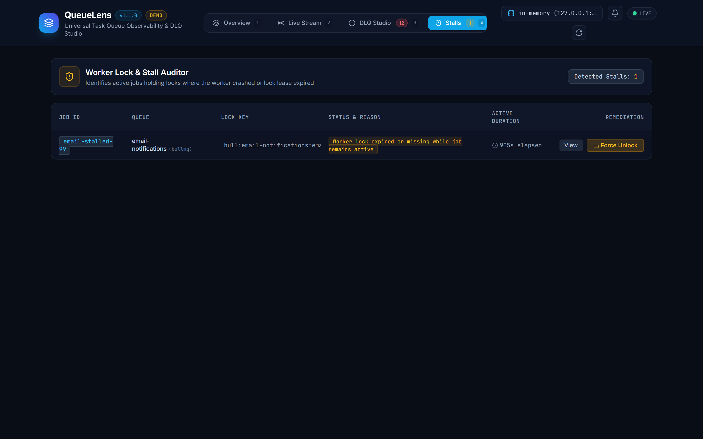
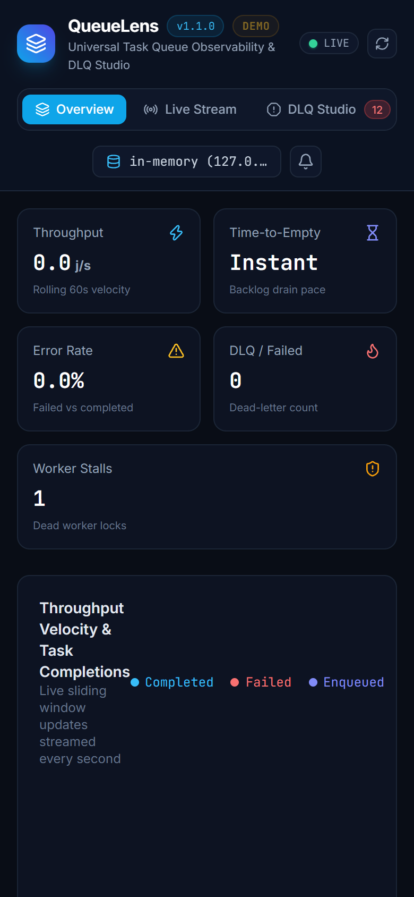

<p align="center">
  
</p>

<h1 align="center">QueueLens</h1>

<p align="center">
  <a href="https://github.com/alexandrmotologa/queuelens/actions"></a>
  <a href="https://go.dev/"></a>
  <a href="https://react.dev/"></a>
  <a href="https://redis.io/"></a>
  <a href="LICENSE"></a>
</p>

<p align="center">
  Universal background task queue observability studio for Redis and Valkey. Auto-detects BullMQ, Celery, Asynq, and Sidekiq queues, tracks job state transitions in real time, audits worker locks to detect stalls, and clusters dead-letter queue failures for 1-click remediation.
</p>



---

## Capabilities

- **Universal Auto-Discovery**: Identifies active queues across Node.js BullMQ, Python Celery, Go Asynq, and Ruby Sidekiq without requiring code changes or agents inside your worker containers.
- **Real-Time Job Lifecycle Visualizer**: Streams state transitions (`waiting` -> `active` -> `completed` / `failed` -> `delayed`) via WebSockets with zero page refreshes.
- **Queue Controls (Pause, Resume & Drain)**: Pause queue consumption during downstream database or API outages, and safely drain waiting backlogs directly from the UI or REST API.
- **Worker Stall & Lock Leak Auditor**: Detects zombie active jobs holding Redis locks whose worker heartbeat expired or crashed mid-execution, providing a 1-click force unlock mechanism.
- **DLQ Studio & Error Signature Clustering**: Normalizes dynamic timestamps, UUIDs, hostnames, and identifiers from error traces to aggregate thousands of failures into actionable root causes.
- **1-Click Mass Replay**: Re-enqueues failed clusters with configurable token-bucket rate limiting (5 to 250 jobs/sec) to avoid cascading retry storms against downstream databases and APIs.
- **Batch Transform (Find & Replace)**: Fix malformed URLs or parameters across thousands of failed job payloads in a single operation before re-enqueuing.
- **Portable DLQ Snapshots (Export & Import)**: Download failure clusters as JSON or CSV bundles for offline post-mortem debugging, and import remediated bundles back into Redis.
- **Predictive Metrics & SLA Tracking**: Real-time Time-to-Empty (TTE) burn-down estimation ($T_{\text{empty}} = \text{Backlog} / \text{Throughput}$) and automated SLA breach alerts.
- **Operational Webhooks**: Outbound alerts for Slack, Discord, PagerDuty, or custom HTTP webhooks when stalls are detected or error rates spike.
- **Hot-Swappable Redis Connections**: Switch between Local, Staging, and Production Redis instances directly from the UI without restarting the binary.
- **Single Static Binary**: The React 19 web dashboard is compiled and embedded into the Go binary (`//go:embed`), requiring zero Node.js runtime on production servers.
- **Zero-Dependency Demo Mode**: Run with `--demo` to start an in-process Redis engine pre-loaded with synthetic multi-framework workloads.

---

## User Interface

### Queue Overview, Lifecycle Controls & Velocity
Visualizes queue depth, active worker concurrency, Time-to-Empty drain pace, proportional state distributions, and rolling 60-second throughput (jobs/sec) alongside Pause/Resume controls.



### Real-Time Transition Stream with Deep Search
Virtualized event table monitoring state transitions, execution runtimes, and wait latencies with full-text payload searching and sliding time filters (15m, 1h, 24h).



### Dead-Letter Queue (DLQ) Remediation Studio
Groups failed jobs by normalized error signature, displays sample stack traces, and provides 1-click mass replay, batch find-and-replace, and JSON/CSV bundle export.



### Worker Stall & Lock Monitor
Audits active job lease keys, compares worker heartbeats, and flags orphaned locks left behind by killed or OOM workers with 1-click force unlock.



### Responsive Mobile & Tablet Layout
Adaptive interface layout with horizontal scroll navigation, touch-friendly queue controls, and stacked metrics for mobile phones and tablet viewports.

<p align="center">
  
</p>

---

## Quick Start

### Installation

#### Pre-built Binary
Download the pre-compiled binary for Linux, macOS, or Windows from the GitHub Releases page:

```bash
# Verify installation
queuelens version
```

#### Build from Source
Requirements: Go 1.23+ and Node.js 20+ (for compiling the frontend).

```bash
git clone https://github.com/alexandrmotologa/queuelens.git
cd queuelens

# Build frontend assets
cd web
npm install
npm run build
cd ..

# Compile single binary
go build -o queuelens ./cmd/queuelens
```

---

## Usage

### 1. Zero-Dependency Demo Mode
Evaluate QueueLens immediately without configuring a local Redis server:

```bash
./queuelens --demo
```
Access the web dashboard at `http://localhost:9190`.

### 2. Connect to Redis or Valkey
Point QueueLens to any standalone Redis instance, Valkey server, or managed cluster:

```bash
# Connect with default port 9190
./queuelens serve --redis-url "redis://:yourpassword@127.0.0.1:6379/0"

# Custom port
./queuelens serve --redis-url "redis://10.0.1.50:6379" --port 8080

# Using environment variables
export REDIS_URL="redis://127.0.0.1:6379/0"
export PORT="9190"
export WEBHOOK_URL="https://hooks.slack.com/services/..."
./queuelens serve
```

### 3. Keyboard Shortcuts

| Key | Action |
| :--- | :--- |
| `1` | Switch to Overview tab |
| `2` | Switch to Live Stream tab |
| `3` | Switch to DLQ Studio tab |
| `4` | Switch to Stall Monitor tab |
| `/` | Focus search bar in Live Stream |
| `r` / `R` | Trigger instant data refresh |
| `Esc` | Close open modals |

### 4. Command Line Diagnostics

#### Inspect Queues via CLI
Print an ASCII overview table of detected queues, job states, and worker counts:

```bash
./queuelens stats --redis-url "redis://127.0.0.1:6379/0"
```

Output:
```text
QUEUE                    TYPE       WAITING  ACTIVE   FAILED   DELAYED  TOTAL   
--------------------------------------------------------------------------------
email-notifications      bullmq     8        1        5        0        14      
image-processing         bullmq     6        0        0        0        6       
report-generation        asynq      4        0        3        0        7       
webhook-delivery         sidekiq    5        0        4        0        9       
--------------------------------------------------------------------------------
Total detected queues: 4
```

#### Review Dead-Letter Clusters
```bash
./queuelens dlq list --redis-url "redis://127.0.0.1:6379/0"
```

Output:
```text
CLUSTER ID   COUNT    QUEUES               ERROR SIGNATURE                       
--------------------------------------------------------------------------------
1927816237ef 5        email-notifications  ConnectionRefused: dial tcp <HOST:PORT>
6df1da24c59e 4        webhook-delivery     Stripe::RateLimitError: HTTP <NUM>... 
d6d5e7fafcfd 3        report-generation    pgx: connection pool exhausted...     
--------------------------------------------------------------------------------
Total dead jobs: 12 across 3 distinct error clusters
```

---

## Supported Task Queue Frameworks

| Framework | Language | Discovery Pattern | State Tracking | Pause / Resume Mechanism | Stall / Lock Detection |
| :--- | :--- | :--- | :--- | :--- | :--- |
| **BullMQ & Bull** | TypeScript / Node.js | `bull:*:meta`, `bull:*:wait` | Lists, Hashes, Sorted Sets | `bull:<q>:meta` `paused` flag & `bull:<q>:paused` | `bull:<q>:<id>:lock` TTL check |
| **Celery** | Python | `celery`, `celery-task-meta-*` | Task Lists, Result Hashes | `celery:<q>:paused` key | Active task metadata state |
| **Asynq** | Go | `asynq:queues`, `asynq:{*}:*` | Sorted Sets, Task Hashes | `asynq:{<q>}:paused` key | `asynq:{<q>}:lease:<id>` TTL check |
| **Sidekiq** | Ruby | `queues`, `queue:*`, `dead` | Lists, Sorted Sets (`dead`, `retry`) | `queues:paused` Set & `queue:<q>:paused` | Process heartbeat validation |

---

## REST API Reference

| Endpoint | Method | Description |
| :--- | :--- | :--- |
| `/api/status` | `GET` | Server connection details, Redis version, memory and keys count |
| `/api/connect` | `POST` | Hot-swap active Redis/Valkey target endpoint |
| `/api/queues` | `GET` | List all discovered queues with real-time state counters |
| `/api/queues/{type}/{name}/jobs` | `GET` | List jobs by state with payload search and time filters |
| `/api/queues/{type}/{name}/pause` | `POST` | Pause queue consumption |
| `/api/queues/{type}/{name}/resume` | `POST` | Resume queue consumption |
| `/api/queues/{type}/{name}/drain` | `POST` | Drop waiting backlog |
| `/api/jobs/{type}/{name}/{id}` | `GET` | Retrieve job details, raw payload and execution metrics |
| `/api/jobs/{type}/{name}/{id}/retry` | `POST` | Retry job with optional in-place mutated payload JSON |
| `/api/dlq/clusters` | `GET` | Normalized error clusters across all failed jobs |
| `/api/dlq/replay` | `POST` | Rate-limited mass retry for cluster or list of job IDs |
| `/api/dlq/export` | `GET` | Export failed jobs snapshot as JSON or CSV bundle |
| `/api/dlq/import` | `POST` | Import and re-enqueue external DLQ bundle |
| `/api/dlq/batch-transform` | `POST` | Find-and-replace text across cluster payloads and replay |
| `/api/stalls` | `GET` | List detected worker stalls and expired lock warnings |
| `/api/stalls/unlock` | `POST` | Force release an orphaned task lock |
| `/api/alerts/config` | `GET/POST` | Get or update webhook alert endpoint URL |
| `/api/alerts/test` | `POST` | Dispatch test webhook notification |
| `/api/metrics` | `GET` | Velocity time series, Time-to-Empty and SLA status |
| `/api/ws` | `GET` | WebSocket live feed for real-time state changes |

---

## Architecture

QueueLens utilizes non-blocking `SCAN` iteration to avoid locking Redis event loops. Read operations inspect metadata hashes and sorted sets, while write operations (such as DLQ retry or lock release) execute atomically via Redis pipelines.

For detailed wire formats, clustering algorithms, and state machine transitions, see [docs/ARCHITECTURE.md](docs/ARCHITECTURE.md).

---

## License

MIT License. Copyright (c) 2026 Alexandr Motologa.
